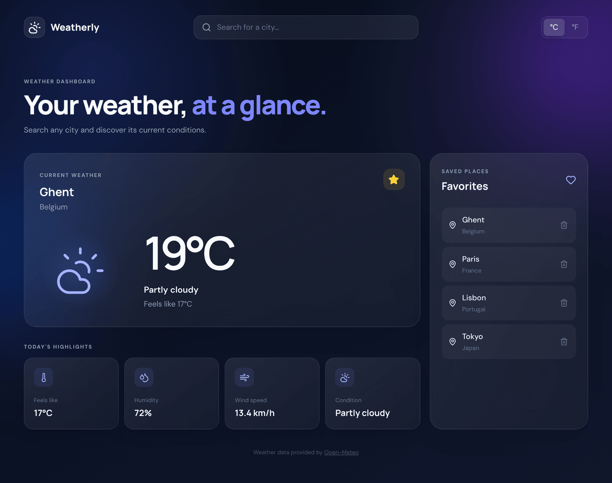

# Weatherly

A full-stack weather dashboard: search any city, see its current weather in
Celsius or Fahrenheit, and keep a list of favorite cities.

**[Try the live demo](https://weatherly-sarahmertens.netlify.app)**



Originally built as a take-home assignment for a full-stack internship. The
brief asked for the current weather, a city picker, a Fahrenheit option and
favorite cities, with a separate frontend and backend and a free choice of
technology.

## Features

- City search with debouncing (one request per search, not per keystroke)
- Current temperature, feels-like temperature, humidity, wind speed and
  weather condition with a matching icon
- Celsius / Fahrenheit toggle
- Favorite cities stored in MySQL; the same location cannot be saved twice
- Loading, empty and error states for every request
- Responsive layout ([mobile screenshot](docs/screenshot-mobile.png)) and
  keyboard-accessible controls
- REST API documented with Swagger

## Tech stack

| Part     | Technology                                                    |
| -------- | ------------------------------------------------------------- |
| Frontend | React 19, Vite, Tailwind CSS 4, Axios                         |
| Backend  | NestJS 11, TypeScript, Drizzle ORM, class-validator, Swagger  |
| Database | MySQL 8 (Docker Compose)                                      |
| Testing  | Jest, Supertest, Testcontainers (backend) · Cypress (frontend)|
| CI       | GitHub Actions: lint, build and all tests on every push       |

## Architecture

```text
React / Vite frontend
        │  REST (JSON)
        ▼
NestJS backend ──────────► Open-Meteo API  (geocoding + current weather)
        │
        ▼
MySQL  (favorite cities)
```

The frontend only ever talks to its own backend. The backend calls
[Open-Meteo](https://open-meteo.com/) (free, no API key) and returns a small,
frontend-friendly response. Weather data is always fetched live and never
stored; MySQL only holds the favorites.

```text
backend/src
├── city/         city search        GET /api/cities/search
├── weather/      current weather    GET /api/weather
├── favorite/     favorites CRUD     /api/favorites
├── open-meteo/   HTTP client for the external API (with timeout)
├── drizzle/      schema, connection, migrations on startup, error filter
└── app.setup.ts  validation, CORS and security headers (shared with the tests)

frontend/src
├── api/          one function per backend endpoint
├── hooks/        useWeather, useFavorites (data loading and state)
├── components/   CitySearch, CurrentWeather, WeatherHighlights, Favorites, UnitToggle
└── pages/        WeatherDashboard
```

## Getting started

Requirements: Node.js 22+, [pnpm](https://pnpm.io/) and Docker.

### 1. Backend

```bash
cd backend
cp .env.example .env
pnpm install
docker compose up -d     # MySQL on port 3307
pnpm start:dev           # migrations are applied automatically on startup
```

- API: <http://localhost:3000/api>
- Swagger: <http://localhost:3000/docs>
- Health check: <http://localhost:3000/api/health>

Optional: `pnpm db:seed` fills the database with a few example favorites.

### 2. Frontend

In a second terminal:

```bash
cd frontend
cp .env.example .env
pnpm install
pnpm dev
```

Open <http://localhost:5173>.

### Demo mode (frontend only)

The live demo runs without the backend. Built with `--mode demo`, the frontend
talks to Open-Meteo directly and keeps favorites in the browser's localStorage.
The switch happens in one place, `frontend/src/api/index.js`; components and
hooks are identical in both modes.

```bash
cd frontend
pnpm dev:demo     # develop in demo mode
pnpm build:demo   # what Netlify builds (see netlify.toml)
```

## API

| Method   | Endpoint                                     | Description                              |
| -------- | -------------------------------------------- | ---------------------------------------- |
| `GET`    | `/api/cities/search?q=Ghent`                 | Search cities by name (2–100 characters) |
| `GET`    | `/api/weather?latitude=&longitude=&unit=`    | Current weather; `unit` is `celsius` (default) or `fahrenheit` |
| `GET`    | `/api/favorites`                             | List favorites                           |
| `GET`    | `/api/favorites/:id`                         | Get one favorite                         |
| `POST`   | `/api/favorites`                             | Add a favorite                           |
| `DELETE` | `/api/favorites/:id`                         | Remove a favorite                        |

Example `POST /api/favorites` body:

```json
{
  "cityName": "Ghent",
  "country": "Belgium",
  "latitude": 51.0543,
  "longitude": 3.7174
}
```

Errors use standard status codes: `400` for invalid input (with the messages
grouped per field), `404` for an unknown favorite, `409` for a duplicate
favorite and `503` when Open-Meteo cannot be reached.

## Tests

```bash
# backend
cd backend
pnpm test        # unit tests
pnpm test:e2e    # API tests against a real MySQL (needs Docker running)

# frontend (start `pnpm dev` first)
cd frontend
pnpm test        # Cypress, headless
pnpm test:ui     # Cypress, interactive
```

- **Backend e2e tests** start the real application and a throwaway MySQL
  container (Testcontainers), so they never touch the development database.
  Calls to Open-Meteo are mocked, which keeps the tests fast and independent
  of the network.
- **Frontend tests** mock every backend call with fixtures, so they run
  without a backend.

## Design decisions

- **A backend in front of Open-Meteo.** The frontend stays simple, the
  external API can be swapped without touching the UI, and input is validated
  in one place.
- **Uniqueness lives in the database.** Favorites have a unique index on
  `(latitude, longitude)`. The service simply inserts and a filter translates
  the database's duplicate error into `409 Conflict`. A "check first, then
  insert" approach needs an extra query and still lets two simultaneous
  requests both pass the check.
- **Unit conversion is left to Open-Meteo.** The requested unit is passed
  through, so there is no conversion or rounding logic to maintain.
- **Stale responses are ignored in the UI.** When the user switches city
  before the previous request finished, the late response is dropped, so the
  screen never shows one city's name with another city's weather.
- **Tests run against the same setup as production.** Validation, CORS and
  filters are configured in one function used by both `main.ts` and the tests.

## Possible improvements

- Cache Open-Meteo responses for a few minutes to reduce external calls
- Hourly or multi-day forecast
- User accounts, so favorites are per user instead of global
- A deployed demo (for example the frontend on Vercel and the backend on
  Render or Railway)
